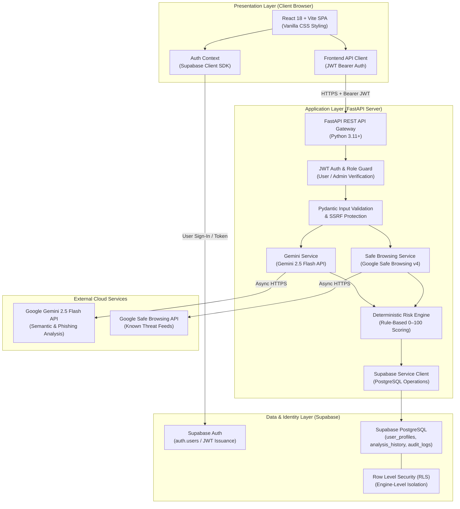
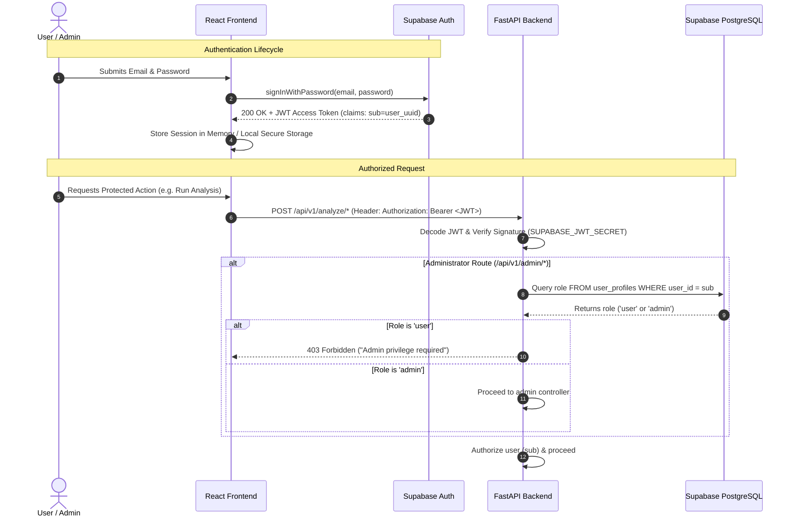
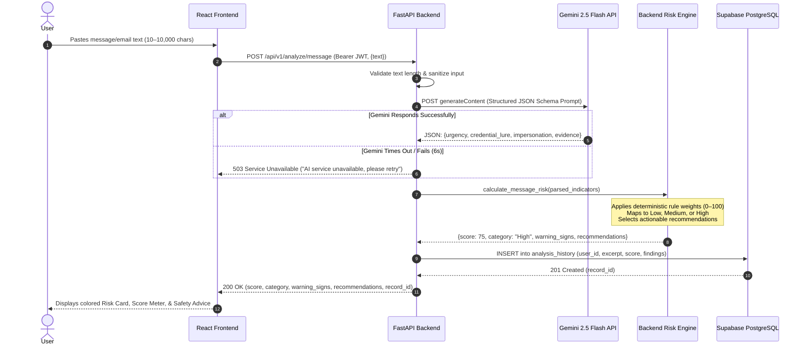
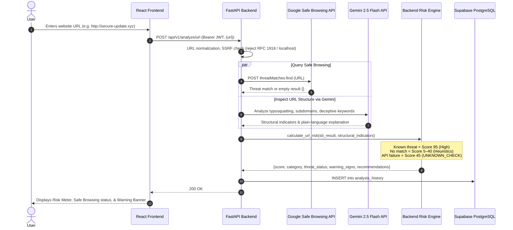
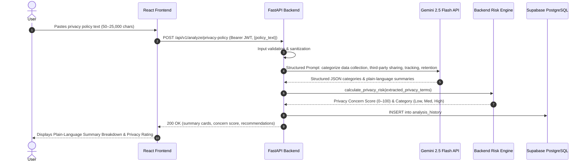

# DataRaksha AI — System Architecture Specification

> **Document Status:** PROPOSED ARCHITECTURE / PENDING IMPLEMENTATION  
> **Target Version:** MVP 1.0  
> **Last Updated:** October 2026  
> **Core Principle:** Separation of heuristic AI explanation from deterministic backend scoring. Zero "100% safe" guarantees.

---

## 1. High-Level System Architecture Overview

DataRaksha AI is built on a decoupled, client-server web architecture designed for security, clarity, and maintainability.



---

## 2. Component Architecture Breakdown

### 2.1 React Frontend (`frontend/`)
- **Technology:** React 18, Vite build tool, Vanilla CSS.
- **Role:** Handles presentation, user interaction, state management, and real-time visual feedback (score meters, warning badges, recommendations).
- **Security Boundaries:**
  - Contains **zero server secrets** or administrative API keys.
  - Communicates with Supabase Auth using only the public `anon` key.
  - Passes user JWT tokens in the `Authorization: Bearer <token>` header to the backend.
  - Performs non-authoritative client validation (length checks, URL syntax) for responsive UX; authoritative validation is strictly enforced on the backend.

### 2.2 FastAPI Backend (`backend/`)
- **Technology:** Python 3.11+, FastAPI, Uvicorn, Pydantic v2, HTTPX.
- **Role:** Serves as the authoritative security gateway and processing coordinator.
- **Responsibilities:**
  - Validates and sanitizes incoming user input.
  - Verifies Supabase JWT tokens and user roles (`user` vs `admin`).
  - Calls external threat and AI APIs asynchronously with timeout guards.
  - Runs the deterministic risk-scoring logic.
  - Writes audit logs and analysis history into Supabase PostgreSQL.

### 2.3 Supabase Auth & Identity
- **Role:** Centralized identity provider for registration, login, password resets, and session management.
- **Token Mechanism:** Issues cryptographic JSON Web Tokens (JWT) containing the user UUID (`sub`).
- **Role Integration:** Custom user roles (`user`, `admin`) are stored in `public.user_profiles` linked to `auth.users(id)`.

### 2.4 Supabase PostgreSQL Database
- **Role:** Relational persistent storage for user profiles, analysis history, and administrative audit logs.
- **Isolation Model:** Protected by PostgreSQL **Row Level Security (RLS)** policies. Every row is bound to `auth.uid()`, preventing cross-user data leakage at the database engine level.

### 2.5 Google Gemini 2.5 Flash API
- **Role:** Natural language understanding and semantic reasoning engine.
- **Usage:**
  - Extracts phishing indicators, urgency markers, and impersonation cues from message text.
  - Summarizes legal privacy policy text into structured categories (data collected, shared, tracked, retention).
  - Explains technical URL structural flags in accessible language.
- **Crucial Rule:** The AI provides linguistic evidence and narrative explanations; **it does not generate the numeric risk score**.

### 2.6 Google Safe Browsing Lookup API (v4)
- **Role:** Authoritative blacklist threat intelligence lookup for malware, social engineering (phishing), and unwanted software.
- **Zero Safe Guarantee Rule:**
  - A threat match confirms malicious status (Score $\ge 85$).
  - An empty result indicates **no known threats cataloged**, not that the website is guaranteed safe.
  - An API error or timeout returns `UNKNOWN_CHECK` with a caution penalty.

---

## 3. User Authentication and Authorization Flow



---

## 4. End-to-End Data Flows

### 4.1 Message and Email Security Analysis Flow



### 4.2 URL Threat Checking Flow



### 4.3 Privacy Policy Analysis Flow



---

## 5. Backend Deterministic Risk-Scoring Engine

The core design principle of DataRaksha AI is the **strict separation between AI prose and numeric risk evaluation**:

```
[ User Input ]
       │
       ▼
[ External Services ] ─── (Gemini extracts boolean flags: urgency=true, asks_otp=true)
                      ─── (Safe Browsing checks known blacklists: match=MALWARE)
       │
       ▼
[ Pure Python Risk Engine ] ─── (Deterministic Rule Calculations: W1 + W2 + ... )
                            ─── (Applies score caps: min(100, sum))
                            ─── (Maps score to Low: 0–39, Medium: 40–69, High: 70–100)
                            ─── (Selects deterministic defensive recommendations)
       │
       ▼
[ Structured JSON Response ]
```

### Key Safety Guarantees
1. **Explainable:** Every point added to the score can be directly traced to a verified indicator or threat list match.
2. **Stable:** Re-evaluating the same set of detected indicators produces the exact same score.
3. **Conservative:** When external APIs fail, the engine adds a provisional caution penalty and labels the result `UNKNOWN_CHECK`, never defaulting to zero risk.

---

## 6. Error Handling, Resilience, and Security Boundaries

### 6.1 Server-Side Request Forgery (SSRF) Defense
Before querying external services for user-submitted URLs:
- The backend parses the hostname and resolves its IP address.
- Addresses in loopback (`127.0.0.0/8`), private RFC 1918 ranges (`10.0.0.0/8`, `172.16.0.0/12`, `192.168.0.0/16`), and cloud link-local metadata ranges (`169.254.169.254`) are **immediately rejected** with `422 Unprocessable Entity`.

### 6.2 External API Resilience Matrix

| Failure Mode | Detection | System Action | User Impact |
| :--- | :--- | :--- | :--- |
| **Gemini Rate Limit (429)** | HTTP 429 received from Gemini API | Intercepted in service layer; returns 503 with retry-after header | *"Analysis service is experiencing high traffic. Please retry in 30 seconds."* |
| **Gemini Timeout (> 6s)** | `asyncio.TimeoutError` triggered | Aborts request; logs warning | *"AI service took too long to respond. Please try again."* |
| **Safe Browsing Unreachable** | HTTP 5xx or connection error | Threat status marked `UNKNOWN_CHECK`; base caution score applied | Result displayed with prominent warning: *"Threat database unreachable. Exercise caution."* |
| **Supabase DB Write Error** | DB exception on history save | Analysis result returned to client; logs error | Result returned successfully; notice: *"Could not save this scan to your history."* |

### 6.3 Security Boundaries & Secret Isolation
- **Secret Isolation:** `GEMINI_API_KEY`, `SAFE_BROWSING_API_KEY`, `SUPABASE_SERVICE_ROLE_KEY`, and `SUPABASE_JWT_SECRET` reside strictly in `backend/.env`.
- **Client Security:** Frontend uses only `VITE_SUPABASE_ANON_KEY` for client-side authentication handshakes.
- **Data Minimization:** Full raw message text is never permanently stored in the database. Only an abbreviated 255-character excerpt and a SHA-256 hash are recorded.
