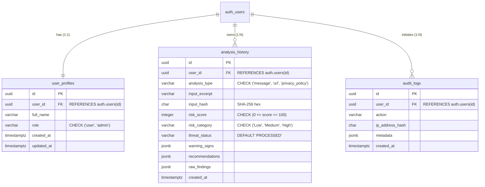

# DataRaksha AI — Supabase Database Schema & Security Design

> **Document Status:** PROPOSED SCHEMA / PENDING IMPLEMENTATION  
> **Database Engine:** Supabase PostgreSQL 15+ ONLY  
> **Identity Provider:** Supabase Auth (`auth.users`) ONLY  
> **Notice:** This document contains proposed database designs and DDL migration scripts for review. No live tables or migration scripts have been created yet.

---

## 1. Schema Architecture and Design Principles

1. **Sole Database Constraint:** DataRaksha AI relies exclusively on **Supabase PostgreSQL**. No SQLite, MongoDB, MySQL, or Firebase components are permitted.
2. **Identity Integration:** Authentication is delegated to Supabase Auth (`auth.users`). User records are bound to Supabase Auth UUIDs through foreign key relationships.
3. **Database-Level Isolation:** All application tables reside in the `public` schema and have **Row Level Security (RLS)** strictly enabled. PostgreSQL enforces tenant isolation even if an application-layer bug occurs.
4. **Data Minimization & Privacy:** Full raw texts (which may contain personal or confidential user data) are not stored permanently. Instead, the database stores:
   - A truncated 255-character excerpt (`input_excerpt`) for user recognition.
   - A SHA-256 cryptographic hash (`input_hash`) for deduplication and audit integrity.
   - Structured JSON findings (`warning_signs`, `recommendations`).

---

## 2. Entity Relationship Diagram (ERD)



---

## 3. Table Definitions & Constraints

### 3.1 Table: `public.user_profiles`
Extends `auth.users` with application-specific metadata and role-based permissions.

| Column | Type | Constraints | Description |
| :--- | :--- | :--- | :--- |
| `id` | `UUID` | `PRIMARY KEY`, Default `gen_random_uuid()` | Unique profile identifier |
| `user_id` | `UUID` | `NOT NULL`, `UNIQUE`, `REFERENCES auth.users(id) ON DELETE CASCADE` | Link to Supabase Auth identity |
| `full_name` | `VARCHAR(100)` | `NULL` | Optional user display name |
| `role` | `VARCHAR(20)` | `NOT NULL`, `DEFAULT 'user'`, `CHECK (role IN ('user', 'admin'))` | User role for authorization |
| `created_at`| `TIMESTAMPTZ` | `NOT NULL`, `DEFAULT now()` | Profile creation timestamp |
| `updated_at`| `TIMESTAMPTZ` | `NOT NULL`, `DEFAULT now()` | Profile last modified timestamp |

### 3.2 Table: `public.analysis_history`
Stores analysis submissions, calculated scores, and safety recommendations for authenticated users.

| Column | Type | Constraints | Description |
| :--- | :--- | :--- | :--- |
| `id` | `UUID` | `PRIMARY KEY`, Default `gen_random_uuid()` | Unique record identifier |
| `user_id` | `UUID` | `NOT NULL`, `REFERENCES auth.users(id) ON DELETE CASCADE` | Owner of the analysis entry |
| `analysis_type` | `VARCHAR(30)` | `NOT NULL`, `CHECK (analysis_type IN ('message', 'url', 'privacy_policy'))` | Category of analysis |
| `input_excerpt`| `VARCHAR(255)` | `NOT NULL` | Sanitized preview text for user history view |
| `input_hash` | `CHAR(64)` | `NOT NULL` | SHA-256 hash of submitted content |
| `risk_score` | `INTEGER` | `NOT NULL`, `CHECK (risk_score >= 0 AND risk_score <= 100)` | Deterministic score (0–100) |
| `risk_category`| `VARCHAR(10)` | `NOT NULL`, `CHECK (risk_category IN ('Low', 'Medium', 'High'))` | Qualitative risk tier |
| `threat_status`| `VARCHAR(30)` | `NOT NULL`, `DEFAULT 'PROCESSED'` | `CLEAN`, `MATCHED`, or `UNKNOWN_CHECK` |
| `warning_signs`| `JSONB` | `NOT NULL`, `DEFAULT '[]'::jsonb` | Extracted threat indicators |
| `recommendations`| `JSONB`| `NOT NULL`, `DEFAULT '[]'::jsonb` | Actionable safety recommendations |
| `raw_findings` | `JSONB` | `NULL` | Technical API responses |
| `created_at` | `TIMESTAMPTZ` | `NOT NULL`, `DEFAULT now()` | Record creation timestamp |

### 3.3 Table: `public.audit_logs`
Stores security events, administrative checks, and operational audit trails.

| Column | Type | Constraints | Description |
| :--- | :--- | :--- | :--- |
| `id` | `UUID` | `PRIMARY KEY`, Default `gen_random_uuid()` | Unique log identifier |
| `user_id` | `UUID` | `NULL`, `REFERENCES auth.users(id) ON DELETE SET NULL` | Performing user (if authenticated) |
| `action` | `VARCHAR(100)` | `NOT NULL` | Description of action (e.g. `ADMIN_STATS_ACCESSED`) |
| `ip_address_hash`| `CHAR(64)` | `NULL` | Hashed client IP for rate monitoring |
| `metadata` | `JSONB` | `DEFAULT '{}'::jsonb` | Contextual details (route, user-agent, status) |
| `created_at` | `TIMESTAMPTZ` | `NOT NULL`, `DEFAULT now()` | Event log timestamp |

---

## 4. Proposed SQL Migration Scripts (DDL)

```sql
-- =============================================================================
-- Migration 001: Create Tables and Triggers
-- =============================================================================

-- 1. Enable UUID Extension
CREATE EXTENSION IF NOT EXISTS "uuid-ossp";

-- 2. Create User Profiles Table
CREATE TABLE IF NOT EXISTS public.user_profiles (
    id UUID PRIMARY KEY DEFAULT gen_random_uuid(),
    user_id UUID NOT NULL UNIQUE REFERENCES auth.users(id) ON DELETE CASCADE,
    full_name VARCHAR(100),
    role VARCHAR(20) NOT NULL DEFAULT 'user' CHECK (role IN ('user', 'admin')),
    created_at TIMESTAMPTZ NOT NULL DEFAULT now(),
    updated_at TIMESTAMPTZ NOT NULL DEFAULT now()
);

-- 3. Create Analysis History Table
CREATE TABLE IF NOT EXISTS public.analysis_history (
    id UUID PRIMARY KEY DEFAULT gen_random_uuid(),
    user_id UUID NOT NULL REFERENCES auth.users(id) ON DELETE CASCADE,
    analysis_type VARCHAR(30) NOT NULL CHECK (analysis_type IN ('message', 'url', 'privacy_policy')),
    input_excerpt VARCHAR(255) NOT NULL,
    input_hash CHAR(64) NOT NULL,
    risk_score INTEGER NOT NULL CHECK (risk_score >= 0 AND risk_score <= 100),
    risk_category VARCHAR(10) NOT NULL CHECK (risk_category IN ('Low', 'Medium', 'High')),
    threat_status VARCHAR(30) NOT NULL DEFAULT 'PROCESSED',
    warning_signs JSONB NOT NULL DEFAULT '[]'::jsonb,
    recommendations JSONB NOT NULL DEFAULT '[]'::jsonb,
    raw_findings JSONB,
    created_at TIMESTAMPTZ NOT NULL DEFAULT now()
);

-- 4. Create Audit Logs Table
CREATE TABLE IF NOT EXISTS public.audit_logs (
    id UUID PRIMARY KEY DEFAULT gen_random_uuid(),
    user_id UUID REFERENCES auth.users(id) ON DELETE SET NULL,
    action VARCHAR(100) NOT NULL,
    ip_address_hash CHAR(64),
    metadata JSONB DEFAULT '{}'::jsonb,
    created_at TIMESTAMPTZ NOT NULL DEFAULT now()
);

-- 5. Trigger: Automatically Create Profile on Signup
CREATE OR REPLACE FUNCTION public.handle_new_user()
RETURNS TRIGGER AS $$
BEGIN
    INSERT INTO public.user_profiles (user_id, full_name, role)
    VALUES (NEW.id, NEW.raw_user_meta_data->>'full_name', 'user');
    RETURN NEW;
END;
$$ LANGUAGE plpgsql SECURITY DEFINER;

CREATE OR REPLACE TRIGGER on_auth_user_created
    AFTER INSERT ON auth.users
    FOR EACH ROW EXECUTE FUNCTION public.handle_new_user();

-- Indexes for Query Performance
CREATE INDEX IF NOT EXISTS idx_analysis_history_user_id ON public.analysis_history(user_id);
CREATE INDEX IF NOT EXISTS idx_analysis_history_created_at ON public.analysis_history(created_at DESC);
CREATE INDEX IF NOT EXISTS idx_audit_logs_created_at ON public.audit_logs(created_at DESC);
```

---

## 5. Row Level Security (RLS) Policies

All public tables enforce strict RLS policies to guarantee data privacy.

```sql
-- =============================================================================
-- Migration 002: Row Level Security (RLS) Policies
-- =============================================================================

-- Enable RLS on all tables
ALTER TABLE public.user_profiles ENABLE ROW LEVEL SECURITY;
ALTER TABLE public.analysis_history ENABLE ROW LEVEL SECURITY;
ALTER TABLE public.audit_logs ENABLE ROW LEVEL SECURITY;

-- -----------------------------------------------------------------------------
-- Policies for user_profiles
-- -----------------------------------------------------------------------------

-- Users can view their own profile
CREATE POLICY "Users view own profile"
    ON public.user_profiles FOR SELECT
    USING (auth.uid() = user_id);

-- Users can update their own display name
CREATE POLICY "Users update own profile"
    ON public.user_profiles FOR UPDATE
    USING (auth.uid() = user_id)
    WITH CHECK (auth.uid() = user_id);

-- Admins can view all user profiles
CREATE POLICY "Admins view all profiles"
    ON public.user_profiles FOR SELECT
    USING (
        EXISTS (
            SELECT 1 FROM public.user_profiles
            WHERE user_id = auth.uid() AND role = 'admin'
        )
    );

-- -----------------------------------------------------------------------------
-- Policies for analysis_history
-- -----------------------------------------------------------------------------

-- Users can view ONLY their own analysis history
CREATE POLICY "Users view own history"
    ON public.analysis_history FOR SELECT
    USING (auth.uid() = user_id);

-- Users can insert records tied to their own user_id
CREATE POLICY "Users insert own history"
    ON public.analysis_history FOR INSERT
    WITH CHECK (auth.uid() = user_id);

-- Users can delete their own records
CREATE POLICY "Users delete own history"
    ON public.analysis_history FOR DELETE
    USING (auth.uid() = user_id);

-- Admins can query aggregate history metrics
CREATE POLICY "Admins view aggregate history"
    ON public.analysis_history FOR SELECT
    USING (
        EXISTS (
            SELECT 1 FROM public.user_profiles
            WHERE user_id = auth.uid() AND role = 'admin'
        )
    );

-- -----------------------------------------------------------------------------
-- Policies for audit_logs
-- -----------------------------------------------------------------------------

-- Only admins can read audit logs
CREATE POLICY "Only admins read audit logs"
    ON public.audit_logs FOR SELECT
    USING (
        EXISTS (
            SELECT 1 FROM public.user_profiles
            WHERE user_id = auth.uid() AND role = 'admin'
        )
    );

-- Backend service role can insert audit logs (bypasses RLS via service key)
```

---

## 6. Data Privacy and Retention Considerations

1. **Minimizing Sensitive PII:** Raw messages may contain personal conversations, bank names, or account numbers. By storing only the first 255 characters (`input_excerpt`) alongside a one-way cryptographic SHA-256 hash (`input_hash`), the system protects user privacy while preserving audit trails.
2. **User Right to Erasure:** Under the RLS `DELETE` policy, users have full authority to delete their past analysis entries at any time via the frontend history dashboard.
3. **Cascading Deletion:** When a user account is deleted from `auth.users`, all linked profile rows and analysis history records are automatically deleted via PostgreSQL `ON DELETE CASCADE`.
