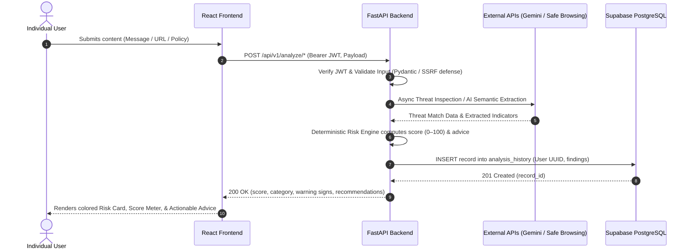

# DataRaksha AI — Final Project Documentation

> **Project Name:** DataRaksha AI  
> **Tagline:** Stay Safe in the Digital World  
> **Document Status:** PROPOSED ARCHITECTURAL SPECIFICATION (PRE-IMPLEMENTATION)  
> **Target Release:** Minimum Viable Product (MVP 1.0)  
> **Document Purpose:** Complete functional, non-functional, security, and architectural specifications for DataRaksha AI.

---

## 1. Introduction and Project Overview

The modern digital landscape presents severe security risks for everyday internet users. Non-technical individuals are frequently targeted by deceptive social engineering tactics, fraudulent SMS messages (smishing), misleading emails, malicious hyperlinks, and opaque privacy policies designed to obscure invasive data tracking.

**DataRaksha AI** is an intelligent, user-centric digital safety web application built to empower users with real-time digital threat analysis. The application provides three primary analysis capabilities:
1. **Suspicious Message & Email Analysis:** Evaluates text for urgency markers, credential-harvesting lures, and authority impersonation.
2. **URL Threat Checking:** Inspects hyperlinks against Google Safe Browsing threat feeds and evaluates structural link anomalies.
3. **Privacy Policy Simplification:** Translates dense legal terms into plain-language summaries highlighting data collection, third-party sharing, tracking, and user rights.

To maintain integrity and prevent artificial safety claims, DataRaksha AI separates **natural language AI explanations** (powered by Google Gemini 2.5 Flash) from a **deterministic backend risk-scoring engine**. The application computes an explainable 0–100 score and assigns a Low, Medium, or High risk category based on rule-based backend calculations.

---

## 2. Problem Statement

Everyday consumers face four critical challenges when navigating digital communication:
1. **Sophisticated Social Engineering:** Phishing messages impersonate financial institutions, courier services, or government agencies using high-urgency language and threatening deadlines.
2. **Obscure & Deceptive Hyperlinks:** Cybercriminals employ typosquatting, deceptive subdomains, and URL shorteners to mask malicious destinations.
3. **Inaccessible Privacy Policies:** Most online services present multi-page legal documents that ordinary users cannot interpret, leading to uninformed consent regarding personal data harvesting.
4. **Lack of Explainable Guidance:** Traditional antivirus tools often block or allow content without explaining *why*, while general chatbots may hallucinate safety reassurances without systematic verification.

---

## 3. Objectives

- **Demystify Suspicious Communication:** Help users recognize social engineering tactics and credential lures in emails and SMS messages.
- **Provide Verifiable Link Inspection:** Cross-reference submitted URLs against Google Safe Browsing threat intelligence feeds.
- **Summarize Privacy Policies Clearly:** Extract key data collection and sharing clauses in plain language.
- **Deliver Deterministic Risk Ratings:** Calculate explainable 0–100 risk scores and Low/Medium/High categories using auditable backend rules.
- **Provide Actionable Safety Advice:** Offer concrete, protective recommendations (e.g., "Do not click links", "Verify via official phone channels") tailored to detected threats.
- **Maintain Private, Secure Histories:** Allow authenticated users to view and manage their personal scan histories through Supabase PostgreSQL and Row Level Security.
- **Provide Protected Administrative Governance:** Provide designated administrators with protected system inspection tools to monitor system health and audit activity securely.

---

## 4. Project Scope

### 4.1 In Scope (MVP)
- **User Authentication:** Registration, login, session management, and logout using Supabase Auth.
- **Three Analysis Capabilities:** Message analysis, URL security checking, and privacy policy summarization.
- **Deterministic Risk Scoring:** Rule-based backend score calculation (0–100) and risk category assignment.
- **Actionable Advice:** Context-sensitive safety recommendations for every analysis.
- **Personal Analysis History:** Secure timeline of previous scans with individual record deletion for authenticated users.
- **Protected Administrator Portal:** Role-restricted view displaying aggregate platform metrics and system health.
- **Safety Disclaimers:** Visible disclaimers stating that absence of threat entries does not guarantee 100% safety.

### 4.2 Out of Scope (Deferred to Future Scope)
- Company or enterprise multi-tenant accounts, organizational teams, or compliance reporting.
- Automated inbox synchronizations (IMAP, Gmail API, Microsoft Graph API).
- Live browser sandboxing or dynamic JavaScript rendering of malicious links.
- Binary executable, PDF, or document attachment scanning.
- Native mobile applications (iOS/Android) and browser extensions.

---

## 5. Individual User and Administrator Roles

The application strictly implements **only two roles**:

```
                       ┌─────────────────────────┐
                       │       User Roles        │
                       └────────────┬────────────┘
                                    │
           ┌────────────────────────┴────────────────────────┐
           ▼                                                 ▼
┌─────────────────────┐                           ┌─────────────────────┐
│   Individual User   │                           │    Administrator    │
└──────────┬──────────┘                           └──────────┬──────────┘
           │                                                 │
           ├─ Register / Login / Logout                      ├─ All User permissions
           ├─ Submit text / URL / policy                     ├─ View platform usage stats
           ├─ View current analysis result                   ├─ View aggregate threat metrics
           ├─ View own personal history                      └─ View system health / logs
           └─ Delete own history records
```

### 5.1 Individual User
- Registered consumer using DataRaksha AI to inspect personal messages, links, and privacy policies.
- Authorized to access personal scan records strictly isolated by Supabase Row Level Security (`auth.uid() = user_id`).
- Cannot access administrative routes or inspect other users' data.

### 5.2 Administrator
- System operator responsible for platform observability.
- Granted access strictly via database role verification (`role = 'admin'` in `public.user_profiles`).
- Authorized to access `/api/v1/admin/*` to review aggregate scan counts, threat category distributions, and API health.

> **Role Boundary Notice:** Company / Enterprise roles are **strictly excluded** from the MVP and belong exclusively under Future Scope.

---

## 6. Functional and Non-Functional Requirements

### 6.1 Functional Requirements

| Requirement ID | Module | Description | Priority |
| :--- | :--- | :--- | :--- |
| **FR-01** | Auth | System must allow new users to register using email and password via Supabase Auth. | High |
| **FR-02** | Auth | System must allow registered users to log in and obtain a secure Supabase JWT. | High |
| **FR-03** | Auth | System must allow authenticated users to invalidate sessions and log out cleanly. | High |
| **FR-04** | Message Analysis | System must accept suspicious message text input (10 to 10,000 characters). | High |
| **FR-05** | Message Analysis | System must prompt Gemini 2.5 Flash to extract urgency, credential lures, and impersonation cues. | High |
| **FR-06** | URL Checking | System must validate and normalize URLs, rejecting private IP ranges to prevent SSRF. | High |
| **FR-07** | URL Checking | System must query Google Safe Browsing Lookup API (v4) for known threat matches. | High |
| **FR-08** | URL Checking | System must augment URL findings with plain-language structural heuristic explanations. | Medium |
| **FR-09** | URL Checking | System must classify unreachable or failed Safe Browsing checks as `UNKNOWN_CHECK`, never as `SAFE`. | High |
| **FR-10** | Policy Analysis | System must accept privacy policy text (50 to 25,000 characters). | High |
| **FR-11** | Policy Analysis | System must generate a simplified markdown summary covering data collected, shared, tracked, and retention. | High |
| **FR-12** | Risk Scoring | Backend must compute a deterministic score (0–100) using validated rule findings, separate from AI prose. | High |
| **FR-13** | Risk Scoring | Backend must map the score to a qualitative category: Low (0–39), Medium (40–69), or High (70–100). | High |
| **FR-14** | Recommendations | System must return a minimum of 2 actionable safety recommendations for every analysis request. | High |
| **FR-15** | History | System must persist analysis records in Supabase PostgreSQL linked to the authenticated user's UUID. | High |
| **FR-16** | History | Authenticated users must be able to retrieve a paginated list of their own analysis records. | High |
| **FR-17** | History | Authenticated users must be able to delete a specific analysis record belonging to them. | Medium |
| **FR-18** | Admin | System must restrict `/api/v1/admin/*` routes exclusively to verified `admin` role claims. | High |
| **FR-19** | Admin | Admin view must display aggregate counts of analyses by type, risk band, and API error counts. | Medium |
| **FR-20** | Disclaimer | System must display a visible advisory disclaimer stating results are educational and not a 100% security guarantee. | High |

### 6.2 Non-Functional Requirements

| Requirement ID | Category | Specification |
| :--- | :--- | :--- |
| **NFR-01** | Performance | Message and privacy policy analysis must return results within 6.0 seconds under normal API conditions. |
| **NFR-02** | Performance | URL threat checking must return results within 2.5 seconds under normal API conditions. |
| **NFR-03** | Security | All client-to-backend and backend-to-external communications must occur over TLS/HTTPS. |
| **NFR-04** | Security | Secret API keys (`GEMINI_API_KEY`, `SAFE_BROWSING_API_KEY`, `SUPABASE_SERVICE_ROLE_KEY`) must never be exposed to clients. |
| **NFR-05** | Security | Supabase Row Level Security (RLS) must guarantee zero cross-tenant data leakage between individual users. |
| **NFR-06** | Usability | Web user interface must be fully responsive across mobile (320px+), tablet, and desktop screens using Vanilla CSS. |
| **NFR-07** | Usability | Technical jargon must be translated into beginner-friendly explanations with clear visual indicators. |
| **NFR-08** | Reliability | External API timeouts must not crash the backend; the service must return structured error fallbacks. |
| **NFR-09** | Maintainability | Backend must enforce strict Pydantic schemas; frontend must use modular React component structures. |
| **NFR-10** | Scalability | FastAPI backend must be completely stateless to allow containerized horizontal scaling. |

---

## 7. Technology Stack and Architecture Rationale

The technology stack is strictly defined and intentionally chosen:

```
┌─────────────────────────────────────────────────────────────┐
│                     FRONTEND LAYER                          │
│               React 18 + Vite + Vanilla CSS                 │
└──────────────────────────────┬──────────────────────────────┘
                               │ HTTPS / JSON (Axios/Fetch)
                               ▼
┌─────────────────────────────────────────────────────────────┐
│                      BACKEND LAYER                          │
│               Python 3.11+ + FastAPI + Pydantic             │
└──────────────┬──────────────────────────────┬───────────────┘
               │                              │
     Async HTTP Client              Async HTTP Client
               │                              │
               ▼                              ▼
┌──────────────────────────────┐ ┌────────────────────────────┐
│    Gemini 2.5 Flash API      │ │ Google Safe Browsing API   │
│   (Semantic & Phishing AI)   │ │  (Known Threat Feeds v4)   │
└──────────────────────────────┘ └────────────────────────────┘
               │
               ▼
┌─────────────────────────────────────────────────────────────┐
│                    DATABASE & AUTH LAYER                    │
│            Supabase (PostgreSQL 15 + Supabase Auth)         │
│          Enforced with Row Level Security (RLS)             │
└─────────────────────────────────────────────────────────────┘
```

- **Frontend (React + Vite + Vanilla CSS):** Modular, component-driven UI with fast Vite HMR. Vanilla CSS provides complete aesthetic control without heavy CSS framework dependencies.
- **Backend (Python + FastAPI):** Asynchronous speed, automatic OpenAPI documentation, native async HTTP clients (`httpx`), and strict Pydantic v2 data validation.
- **Database (Supabase PostgreSQL ONLY):** Robust relational database with native JSONB support and database-level Row Level Security (RLS).
- **Authentication (Supabase Auth ONLY):** Direct cryptographic JWT authentication integrated with PostgreSQL.
- **AI Analysis (Google Gemini 2.5 Flash):** Fast, cost-efficient, and nuanced linguistic reasoning for phishing detection and legal policy simplification.
- **URL Threat Checking (Google Safe Browsing v4):** Authoritative global threat blacklist lookup.
- **Version Control (Git & GitHub):** Monorepo structure, feature branches, and peer-reviewed pull requests.

---

## 8. Proposed System Workflow

### High-Level End-to-End Workflow



---

## 9. Security and Privacy Requirements

1. **Zero Secret Leakage:** All API keys and secrets reside strictly on the backend in `.env`. The frontend bundle contains only public configuration values (`VITE_SUPABASE_ANON_KEY`, `VITE_API_BASE_URL`).
2. **Server-Side Request Forgery (SSRF) Defense:** URL analysis blocks loopback (`127.0.0.1`), private RFC 1918 ranges (`10.0.0.0/8`, `172.16.0.0/12`, `192.168.0.0/16`), and metadata services (`169.254.169.254`).
3. **Data Minimization:** Full raw message text is never permanently stored in the database. Only an abbreviated 255-character excerpt and a SHA-256 hash are recorded.
4. **Row Level Security (RLS):** All public tables enforce PostgreSQL RLS policies to guarantee that users cannot read or delete records owned by other users.
5. **No Safe Guarantees:** The application explicitly refrains from claiming that any content is guaranteed safe. Inconclusive or failed checks are labeled `UNKNOWN_CHECK`.

---

## 10. Database Overview

The project exclusively uses **Supabase PostgreSQL**. For full details and SQL DDL, see [docs/DATABASE_SCHEMA.md](file:///c:/Users/kalyani%20more/Desktop/DataSecurity/docs/DATABASE_SCHEMA.md).

- **`public.user_profiles`:** Extends `auth.users` with display name and authorization role (`user` or `admin`).
- **`public.analysis_history`:** Stores user scan submissions, calculated risk scores (0–100), categories, threat statuses, warning signs, and recommendations.
- **`public.audit_logs`:** Records administrative actions and system security events.

---

## 11. External API Overview

For full JSON schemas and status codes, see [docs/API_CONTRACT.md](file:///c:/Users/kalyani%20more/Desktop/DataSecurity/docs/API_CONTRACT.md).

- **Google Gemini 2.5 Flash:** Evaluates semantic meaning, phishing tactics, and privacy policy clauses using structured system prompts with JSON output formatting.
- **Google Safe Browsing Lookup API (v4):** Checks URLs against known malware, social engineering, and unwanted software databases.

---

## 12. Testing Strategy

Testing spans unit, integration, and security test cases across both tiers:

| Test ID | Category | Scenario / Input | Expected Outcome |
| :--- | :--- | :--- | :--- |
| **TC-AUTH-01** | Auth | User signs up with valid email and password ($\ge 8$ chars). | Account created in Supabase Auth; profile record created; 201 Created. |
| **TC-AUTH-02** | Auth | User attempts login with wrong password. | Login rejected with 401 Unauthorized; clear error message displayed. |
| **TC-MSG-01** | Analysis | Phishing lure: "Account locked, click http://... immediately". | Gemini identifies urgency and credential lure; risk score $\ge 70$ (High Risk); actionable advice returned. |
| **TC-MSG-02** | Analysis | Benign message: "Hey, are we having lunch at 1 PM?". | Gemini flags no threat indicators; risk score $< 40$ (Low Risk). |
| **TC-URL-01** | URL Check | Known malware test URL. | Google Safe Browsing flags `MALWARE`; score set to 95 (High Risk). |
| **TC-URL-02** | URL Check | Benign URL: `https://www.wikipedia.org`. | Safe Browsing returns clean; heuristic score $< 20$ (Low Risk); no "100% safe" guarantee given. |
| **TC-URL-03** | URL Check | Safe Browsing API simulated as unreachable / timed out. | Returns `threat_status: UNKNOWN_CHECK`; risk score reflects caution; clear warning displayed. |
| **TC-URL-04** | Security | Private IP input: `http://192.168.1.1/admin`. | Backend rejects input as private address (SSRF defense); 422 error. |
| **TC-POL-01** | Policy | Policy clause selling data to advertisers. | Gemini extracts third-party data sharing; risk engine adds points; concern highlighted in summary. |
| **TC-HIST-01** | RLS / History | Authenticated User A queries `/api/v1/history`. | Receives only records where `user_id = User A.id`. |
| **TC-HIST-02** | RLS / History | Authenticated User B attempts to delete User A's record. | Request rejected with 403 Forbidden or 404 Not Found due to RLS; no deletion occurs. |
| **TC-ADM-01** | Admin | Normal user (`role = 'user'`) requests `/api/v1/admin/stats`. | Request rejected with 403 Forbidden. |
| **TC-ADM-02** | Admin | Verified admin (`role = 'admin'`) requests `/api/v1/admin/stats`. | Request succeeds with 200 OK and returns aggregate counts. |

---

## 13. Limitations

1. **Threat Blacklist Lag:** Google Safe Browsing relies on reported threat intelligence feeds. Newly registered zero-day phishing links may not yet appear on blacklists.
2. **AI Interpretation Limits:** LLMs use probabilistic pattern matching. While prompt engineering minimizes hallucinations, edge-case social engineering or nuanced legal clauses may be misinterpreted.
3. **Static Analysis Only:** The MVP evaluates text and URLs. It does not execute live dynamic malware sandboxing, download binaries, or render target web pages in a headless browser.

---

## 14. Future Scope

1. **Company & Enterprise Security Tier:** Multi-tenant organization dashboards, employee phishing reporting, team seat management, and aggregate risk heatmaps.
2. **Automated Email Sync:** OAuth2 integration with Google Workspace and Microsoft 365 for automated mailbox threat scanning.
3. **Browser Extension:** Lightweight Chrome/Firefox extension providing real-time URL warning banners during browsing.
4. **File & Attachment Sandboxing:** Safe inspection of email attachments (.pdf, .docx, .zip) for malicious scripts.
5. **Multilingual Regional Support:** Expanded parsing for Indian regional languages (Hindi, Marathi, Tamil, etc.) to combat localized smishing fraud.

---

## 15. Acceptance Criteria

- **AC-01 (Authentication):** Users can register, log in, and log out with Supabase Auth.
- **AC-02 (Message Analysis):** Accepts text (10–10,000 chars), extracts indicators via Gemini, computes a deterministic 0–100 score, Low/Medium/High category, warning signs, and recommendations.
- **AC-03 (URL Threat Checking):** Normalizes URLs, blocks private IPs, queries Safe Browsing, returns High Risk ($\ge 85$) on threat matches, and flags service downtime as `UNKNOWN_CHECK`.
- **AC-04 (Privacy Policy Analysis):** Parses policy text (50–25,000 chars), summarizes key data rights into categories, and computes a Privacy Concern Rating.
- **AC-05 (Deterministic Scoring):** Risk scores are computed strictly by backend rules, separate from AI narrative text. Missing external checks trigger caution penalties.
- **AC-06 (Analysis History):** Authenticated users can view and delete their own history. Supabase RLS guarantees zero cross-tenant leakage.
- **AC-07 (Administrator Functions):** Protected `/api/v1/admin/*` routes return aggregate platform statistics strictly to users with verified `admin` role.
- **AC-08 (Educational Disclaimers):** All analysis views prominently state that results are advisory and never guarantee 100% digital safety.

---

## 16. Implementation Status Notice

> **CURRENT IMPLEMENTATION STATUS:**  
> All features, database schemas, scoring formulas, and API contracts in this document represent **planned specifications**. As of October 2026, the project is in the requirements and documentation phase. No application code has been written, no live database tables have been provisioned, and no external APIs have been connected. Implementation begins in Phase 2.
